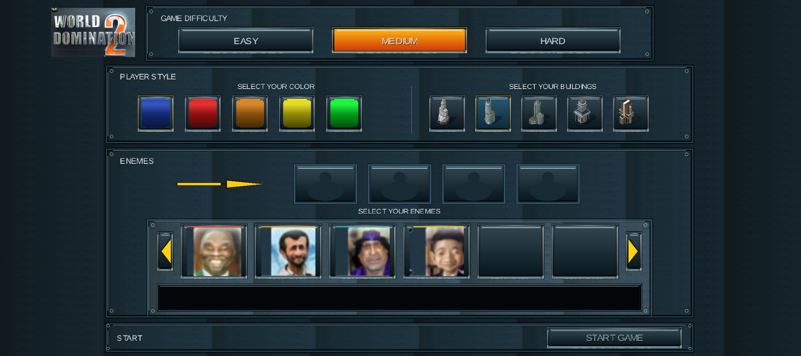
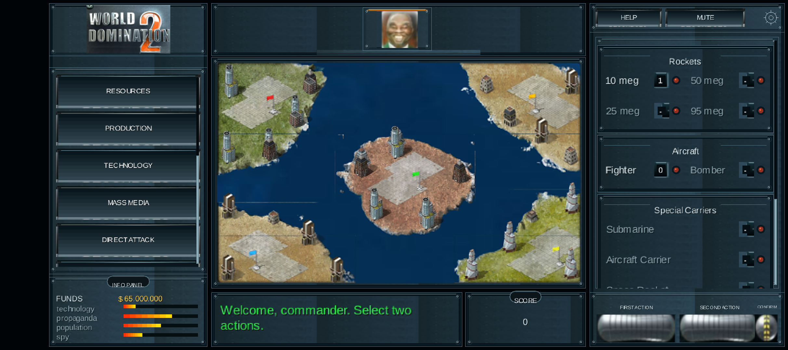

<div align="center">

# World Domination 2 — Android Port

**A native Android recreation of the classic strategy game, built with Java and libGDX.**

[](https://github.com/Rifat-Rashid/WorldDomination2-Android-Port/actions/workflows/android-build.yml)
[](https://github.com/Rifat-Rashid/WorldDomination2-Android-Port/actions/workflows/android-tests.yml)
[](https://github.com/Rifat-Rashid/WorldDomination2-Android-Port/actions/workflows/android-quality.yml)
[](https://openjdk.org/)
[](https://developer.android.com/)

</div>

World Domination 2 is a turn-based strategy game about managing resources, developing technology, building an arsenal, and competing for control of a five-island world. This project brings the game to Android as a Java application rendered with libGDX and OpenGL ES.

> **Development status:** Active. The app builds and runs on Android, and gameplay systems and original Flash-era presentation are being restored and checked against the reference. Feature parity is still in progress.

## Screenshots

Current Android emulator captures of the game setup and gameplay screens:

<p align="center">
  <a href="docs/screenshots/character-selection.png">
    
  </a>
  <a href="docs/screenshots/gameplay.png">
    
  </a>
</p>

<p align="center"><sub>Character and game setup · Five-island battlefield</sub></p>

## Project highlights

- Android-only app written in Java with libGDX; gameplay runs offline without Python, a WebView, or a network service.
- Landscape presentation built around the original five-island battlefield and metallic interface.
- Original game artwork and audio are packaged with the app and loaded through cached asset pipelines.
- Simulation, opponent AI, rendering, UI, audio, assets, and persistence are organized into separate packages.
- Java 11 source compatibility, built with JDK 17 and the Android Gradle Plugin.

The Python game is treated as a read-only behavioral reference. Implemented features are being ported and validated incrementally; screenshots show the current Android build and do not imply full game parity.

## Build and run

Open the repository in Android Studio, let Gradle sync, then run the `app` configuration on an Android emulator or device.

Requirements: JDK 17 and Android SDK Platform 37 with Build Tools 36.0.0.

Build a debug APK on Windows:

```powershell
.\gradlew.bat :app:assembleDebug
```

Run unit tests and lint:

```powershell
.\gradlew.bat :app:testDebugUnitTest :app:lintDebug
```

The debug APK is generated at `app/build/outputs/apk/debug/app-debug.apk`. GitHub Actions validates Android assembly, unit tests, and lint on changes to `main`.

## Code map

| Directory | Responsibility |
| --- | --- |
| `app/src/main/java/com/example/worlddomination/game/simulation/` | Game state, rules, and turn resolution |
| `app/src/main/java/com/example/worlddomination/game/ai/` | Opponent decision making |
| `app/src/main/java/com/example/worlddomination/game/rendering/` | libGDX battlefield, interface, and animation rendering |
| `app/src/main/java/com/example/worlddomination/game/ui/` | Screen layout and interaction behavior |
| `app/src/main/assets/original/` | Packaged original artwork and runtime assets |
| `app/src/test/` | Deterministic gameplay and presentation support tests |
| `docs/screenshots/` | Screenshots shown on this project page |

## License

Source code is licensed under Apache-2.0. See [LICENSE](LICENSE).
